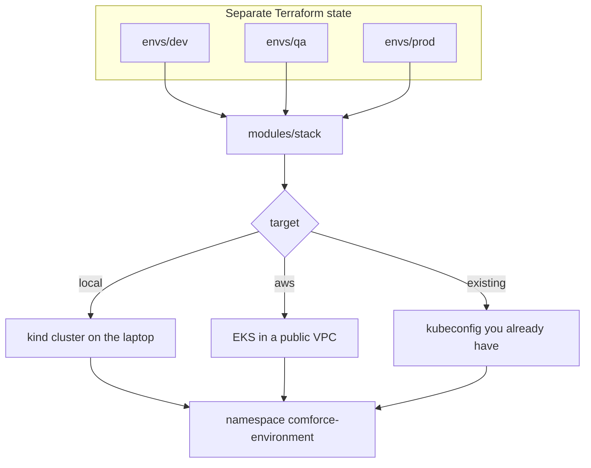
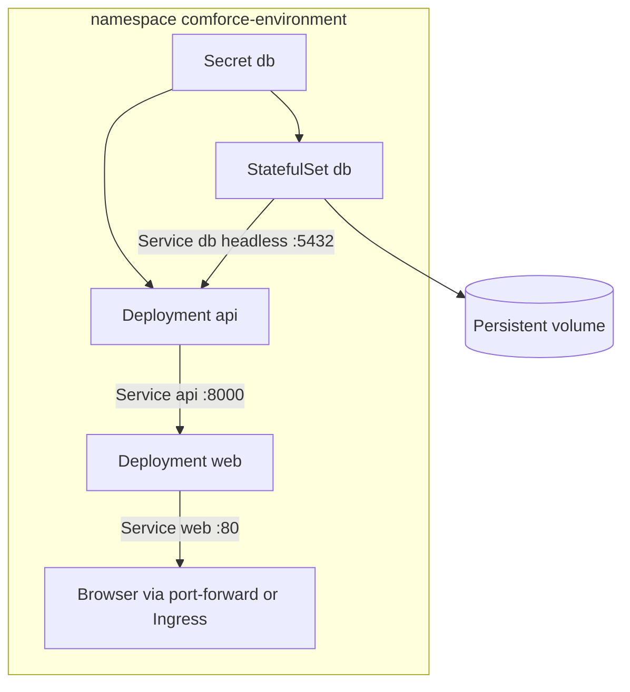
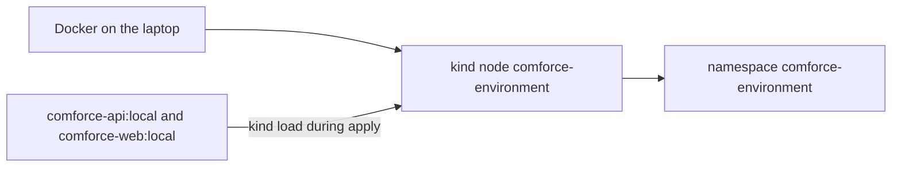
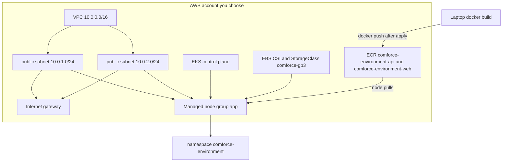

# Cloud architecture

ComForce runs as three processes: PostgreSQL (`db`), FastAPI (`api`), and the React app behind nginx (`web`). Nginx owns the browser origin and forwards `/api` to the API. Dev, qa, and prod each get that same stack, with separate Terraform state so applying one environment does not create or change the others.

Docker Compose is a laptop path beside this. It is not part of the Terraform state. Compose publishes Postgres on `5432`, the API on `8000`, and the web app on `3000`.

The step-by-step commands are in [Kubernetes setup](../deploy/KUBERNETES.md). How the browser, API, and data connect is in [Full-stack architecture](FullStackArchitecture.md).

## One module, three roots

`deploy/terraform/modules/stack` is the cluster and the app. Each environment is a thin root that calls that module and fixes its own name:

| | Directory | Cluster | Namespace | Host port | `APP_ENV` | API / web replicas | Database disk |
| :--- | :--- | :--- | :--- | :--- | :--- | :--- | :--- |
| dev | `deploy/terraform/envs/dev` | `comforce-dev` | `comforce-dev` | 8080 | `development` | 1 / 1 | 1Gi |
| qa | `deploy/terraform/envs/qa` | `comforce-qa` | `comforce-qa` | 8081 | `qa` | 1 / 1 | 2Gi |
| prod | `deploy/terraform/envs/prod` | `comforce-prod` | `comforce-prod` | 8082 | `production` | 2 / 2 | 5Gi |

`environment` is a literal in that directory's `main.tf`. A tfvars file cannot relabel dev as prod. State stays in that directory (`terraform.tfstate`, gitignored) and holds the database password and cluster credentials. The password itself lives in `terraform.tfvars`, also gitignored. Each environment needs its own password.

All three roots default to `target = "local"`. `aws` and `existing` are set in the tfvars of the one environment you mean to put somewhere else. Dev can stay on the laptop while another environment points at AWS, because they do not share state.

## What every environment installs

The module creates the same Kubernetes objects once the cluster answers:

- **db** is `postgres:16-alpine`. One replica. The data directory is a volume claim. On kind the claim uses the cluster default StorageClass. On AWS it uses `comforce-gp3`.
- **api** runs `comforce-api`. It reads `DATABASE_URL` from the secret. Dev sets `APP_ENV=development`, so a database miss at startup leaves the process up and readiness fails. Prod sets `APP_ENV=production`, so a database miss at startup exits the process.
- **web** runs `comforce-web`. Nginx serves the built React app and proxies `/api` to `http://api:8000`.
- **Ingress** is off. Nothing in this stack installs an ingress controller. You open the app with `kubectl port-forward` on the host port in the table. Set `ingress_enabled` only when a controller is already on that cluster.

Local images are `comforce-api:local` and `comforce-web:local`. Terraform loads those tags into kind during apply. `:local` is not pulled from a registry.

## Laptop cluster

`target = "local"` creates a one-node [kind](https://kind.sigs.k8s.io/) cluster named `comforce-<environment>` and writes `~/.kube/comforce-<environment>.yaml`. Kind runs Kubernetes inside Docker on the laptop. The apply also creates `~/.kube` if it is missing, then loads the two local images into that cluster before the pods start.

Dev is the cluster that has been applied: `comforce-dev`, kubeconfig `~/.kube/comforce-dev.yaml`, app at `http://[::1]:8080` when that port-forward is running. On this laptop, IPv4 port 8080 is already used by another program, so the forward is on IPv6 localhost.

## AWS cluster

`target = "aws"` uses an account, region, and profile you choose for this project. The default region is `us-east-1`. The default Kubernetes version is `1.35`. The default worker is one `t3.medium`.

The VPC has two public subnets and no NAT gateway. Nodes get public IPs and reach the control plane and ECR through the internet gateway. The EKS API endpoint is public. The cluster creator gets admin access. The EBS CSI driver is installed as an add-on, with an IAM role for the `ebs-csi-controller-sa` service account, so Postgres can claim a gp3 volume.

ECR repository URLs do not exist until apply finishes. Pods stay in `ImagePullBackOff` until you tag `comforce-api:local` and `comforce-web:local` with those URLs and push them. The worker role can pull from ECR in the same account. Repository tags are mutable, and the repositories delete on `terraform destroy` even after images have been pushed.

EKS bills until that environment is destroyed. A new cluster is about $0.10 per hour for the control plane plus about $0.04 per hour for one `t3.medium` in `us-east-1`, on the order of $3 to $4 per day. Destroy only the directory you applied.

## A cluster you already have

`target = "existing"` installs the same namespace, secret, database, API, and web manifests onto a kubeconfig you pass in. It does not create a kind cluster, a VPC, or ECR. You set `api_image` and `web_image` to something that cluster can pull, and `db_storage_class` when the default StorageClass is the wrong disk.

## What stays off the cloud

The hubs board is in the API process, not in Postgres. Postgres stores the `services` table only. Restarting the API drops board edits that were not also saved in the browser. See [Full-stack architecture](FullStackArchitecture.md).

There is no remote Terraform backend, no NAT gateway, and no ingress controller in this design. Local plans do not call AWS: the AWS provider is given dummy credentials unless `target` is `aws`.
